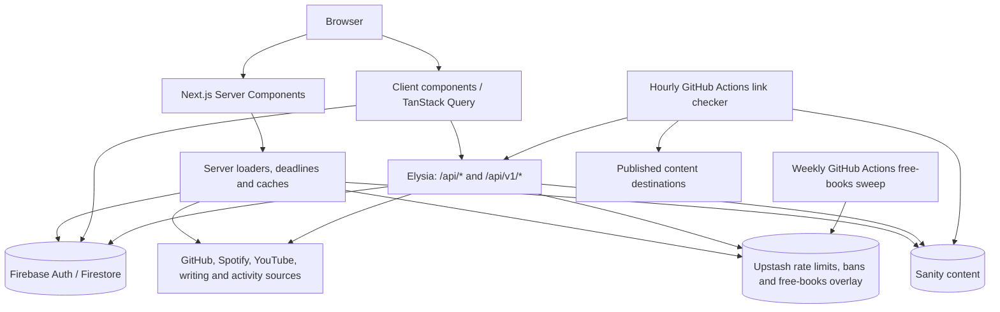

<!--
  Copyright (c) 2026 Mike Odnis

  Licensed under the Apache License, Version 2.0 (the "License");
  you may not use this file except in compliance with the License.
  You may obtain a copy of the License at

      http://www.apache.org/licenses/LICENSE-2.0

  Unless required by applicable law or agreed to in writing, software
  distributed under the License is distributed on an "AS IS" BASIS,
  WITHOUT WARRANTIES OR CONDITIONS OF ANY KIND, either express or implied.
  See the License for the specific language governing permissions and
  limitations under the License.
-->

# mikeodnis.dev

Portfolio, project case studies, writing and live activity for **Mike Odnis**
([WomB0ComB0](https://github.com/WomB0ComB0)). Built with Next.js and deployed at
[mikeodnis.dev](https://mikeodnis.dev).

[](https://github.com/WomB0ComB0/portfolio/releases)


## Contents

- [Architecture](#architecture)
- [Tech Stack](#tech-stack)
- [Routes & Pages](#routes--pages)
- [API Reference](#api-reference)
- [Quick Start](#quick-start)
- [Environment Variables](#environment-variables)
- [Scripts & Tooling](#scripts--tooling)
- [Verification](#verification)
- [Development Notes](#development-notes)
- [License](#license)

---

## Architecture

The site runs as one Next.js App Router application on Vercel. Server Components load and render the
main lists, while client components add filtering, dialogs, authentication and live playback or
presence updates.

- **Pages and shared UI**: route groups live in [`src/app/(routes)`](<src/app/(routes)>). The
  [console components](src/components/console) provide Folio headings, bylines, view switches,
  filter bars, tables and empty states. Projects offers Stories, Index and Screens views, with
  filter state carried in the URL.
- **Server data**: [Sanity loaders](src/lib/sanity/loaders.ts) supply portfolio content.
  [Media](<src/app/(routes)/(dev)/media/_lib/load-feed.ts>) and
  [Stats](<src/app/(routes)/(dev)/stats/_lib/console-loaders.ts>) combine sources with deadlines and
  cached fallbacks. Stats reports source freshness, while Media names unavailable source sections
  separately from empty results. Project case studies load confirmed related Media items through a
  separate bounded loader.
- **HTTP API and client queries**: Elysia routers under `/api/*` and `/api/v1/*` expose integration
  endpoints. Client components call them with plain `fetch`. The live widgets (now playing, service
  status and the Stats Discord tile) poll through TanStack Query with the helpers in
  [`live-json.ts`](src/lib/http-clients/live-json.ts), and the free-books search also uses TanStack
  Query. Effect and Effect Schema run on the server, in the API handlers, integration clients and
  Sanity decoding. Server pages also call loaders directly, without an HTTP round trip through their
  own API.
- **Storage and authentication**: Sanity holds projects, roles, credentials, places, the resume PDF,
  media metadata, site settings and the bookshelf (books, shelves and cover images). Firebase
  handles visitor sign-in and Firestore stores guestbook messages. Upstash Redis holds API rate
  limits, IP/CIDR bans and the free-books security overlay, which the weekly
  [free-books workflow](.github/workflows/free-books-verify.yml) publishes and the `/bookshelf/free`
  catalog reads. Sanity also stores the scheduled link-check results.
- **Observability**: OpenTelemetry, Sentry and Better Stack report requests, errors and uptime.
  Server-rendered navigation links and JSON-LD support crawlers and navigation before hydration.



---

## Tech Stack

| Category                       | Technology                                                                                      | Usage                                                                                                                      |
| :----------------------------- | :---------------------------------------------------------------------------------------------- | :------------------------------------------------------------------------------------------------------------------------- |
| **Runtime & Package Manager**  | Bun (`>=1.4.0`), Node.js (`24.x`)                                                               | Bun installs dependencies and runs scripts; Node.js runs Next.js locally and on Vercel                                     |
| **Framework**                  | Next.js 16, React 19                                                                            | App Router, Server Components, dynamic code splitting, and an installable web app manifest (no service worker)             |
| **API Engine**                 | Elysia.js 1.4                                                                                   | Type-safe REST handlers, OpenTelemetry spans, Server-Timing headers, and CORS                                              |
| **Data Pipeline & Validation** | Effect 4 (`effect/http`, `effect/Schema`), Zod 4                                                | Server-side typed HTTP clients, retry policies and schema decoding (Effect), plus environment and payload validation (Zod) |
| **State & Caching**            | TanStack React Query v5, nuqs, React state/context, Upstash Redis                               | Client query caching, URL filter state, local UI state, and server-side rate limits, ban list and free-books overlay       |
| **Styling & Motion**           | Tailwind CSS v4, Radix UI, Motion 14                                                            | Component primitives, animations, and background lighting                                                                  |
| **CMS & Database**             | Sanity Studio v6 (`sanity`), `@sanity/client` 8, Firebase v13 (`firebase`, `firebase-admin` 14) | Portfolio content management and authenticated guestbook entries                                                           |
| **Observability**              | Sentry 11, OpenTelemetry, Better Stack (`@logtail/node`)                                        | Distributed tracing, error reporting, and `/api/status` uptime aggregation                                                 |
| **Code Quality & Testing**     | Biome 2, Prettier 3, Stylelint, TypeScript 6, Vitest 5, Playwright                              | Linting, formatting, CSS linting, static type checking, unit tests, and Chromium E2E tests                                 |

---

## Routes & Pages

| Route                               | Description                                                                                                                                                                                                                                                     |
| :---------------------------------- | :-------------------------------------------------------------------------------------------------------------------------------------------------------------------------------------------------------------------------------------------------------------- |
| `/`                                 | Home overview with now playing, site status, LeetCode, typing and GitHub tiles, the latest or a featured project, the most recent past place, current roles and a site index.                                                                                   |
| `/projects`                         | Stories, Index and Screens views of the project catalog, with search, kind and technology filters.                                                                                                                                                              |
| `/projects/[id]`                    | Story case studies, project facts, a timeline of neighbouring projects, the repositories a multi-repository project is made of (a private one shows as "Private repository", unlinked), screenshot galleries and confirmed related writing or videos.           |
| `/experience`, `/experience/[id]`   | Current roles, a career timeline and individual role stories.                                                                                                                                                                                                   |
| `/certifications`                   | Featured credentials, year chapters and issuer groups, with credential links and ID copy controls.                                                                                                                                                              |
| `/resume`                           | Sanity PDF with download/open actions, the full direct CDN link, and an optional native preview.                                                                                                                                                                |
| `/media`                            | Writing, Video and Streams sections (Articles, Talks and Presentations each get one once published) with search, kind and series filters, related items and project links. Playback opens externally by default.                                                |
| `/stats`                            | A responsive console for GitHub, coding time, LeetCode, typing, Discord activity and 30-day page views, with source freshness and fallback states.                                                                                                              |
| `/spotify`                          | A listening hero, ranked track ledger and artist strip, with live playback updates after hydration.                                                                                                                                                             |
| `/places`, `/places/[placeId]`      | A map and directory of past visits with photo-journal detail pages, uncropped photos, captions and thumbnail navigation. A place with no date, or whose visit is not yet over (it may still be on, or is still to come), is left out, and its page answers 404. |
| `/places/photos`                    | A photo gallery drawn from the past visits.                                                                                                                                                                                                                     |
| `/guestbook`                        | Visitor notes arranged in a wall by year, with authenticated posting through the API.                                                                                                                                                                           |
| `/bookshelf`                        | A 3D shelf of the books read, being read and queued, shelf by shelf, with status filters, shelf cards and a reading map.                                                                                                                                        |
| `/bookshelf/[slug]`                 | A book's stage: cover, publication facts, summary, numbered topics, ISBN registry links and the previous and next books.                                                                                                                                        |
| `/bookshelf/shelf/[shelfSlug]`      | One shelf's books on the 3D stage.                                                                                                                                                                                                                              |
| `/bookshelf/free`                   | A searchable library of free programming and security books from the EbookFoundation list (an external feed, not Sanity).                                                                                                                                       |
| `/sponsor`                          | Ways to support the work, followed by current and past supporter acknowledgements.                                                                                                                                                                              |
| `/privacy`, `/cookies`, `/licenses` | Privacy, cookie and open-source license disclosures.                                                                                                                                                                                                            |

The command palette (`Cmd/Ctrl+K`) is part of the shared layout and opens on every page. Route-local
components and loaders sit beside each page under `src/app/(routes)`. The `professioal` directory
spelling is part of the existing source layout.

---

## API Reference

### Core Endpoints (`/api/*`)

| Method | Path             | Description                                                                                                                                                                                                |
| :----- | :--------------- | :--------------------------------------------------------------------------------------------------------------------------------------------------------------------------------------------------------- |
| `GET`  | `/api/health`    | Health check with status, uptime, timestamp and app version. `/api/health/detailed` adds a services map, and `/api/health/ready` and `/api/health/live` are readiness and liveness probes                  |
| `GET`  | `/api/status`    | Overall state and up/total count of the unpaused Better Stack Uptime monitors, cached for a minute. When Better Stack fails it serves the last answer marked `stale`, or `unknown`                         |
| `POST` | `/api/admin/ban` | Bearer-authenticated IP and CIDR ban management (`ADMIN_API_TOKEN`); the JSON body's `action` picks ban, unban, slow, list, etc., and an optional `seconds` makes a ban, slow-mode or CIDR entry temporary |

### v1 Endpoints (`/api/v1/*`)

| Method | Path                                         | Upstream Source             | Description                                                                                                                                                                                                            |
| :----- | :------------------------------------------- | :-------------------------- | :--------------------------------------------------------------------------------------------------------------------------------------------------------------------------------------------------------------------- |
| `GET`  | `/api/v1/now-playing`                        | Spotify Web API             | Current playback state, track metadata, and album art                                                                                                                                                                  |
| `GET`  | `/api/v1/top-tracks`                         | Spotify Web API             | Short-term top tracks with resilient pagination fallback                                                                                                                                                               |
| `GET`  | `/api/v1/top-artists`                        | Spotify Web API             | Short-term (last four weeks) top 20 artists with profile links and images                                                                                                                                              |
| `GET`  | `/api/v1/github-stats`                       | GitHub REST API             | Repository counts, stars, followers, top languages and top repositories                                                                                                                                                |
| `GET`  | `/api/v1/github-sponsors`                    | GitHub GraphQL API          | Active and past GitHub Sponsors and tier metadata                                                                                                                                                                      |
| `GET`  | `/api/v1/wakatime`                           | WakaTime API                | Total coding time as text, digital, decimal and seconds values                                                                                                                                                         |
| `GET`  | `/api/v1/leetcode`                           | LeetCode GraphQL            | Solved problem counts by difficulty                                                                                                                                                                                    |
| `GET`  | `/api/v1/lanyard`                            | Lanyard API                 | Live Discord presence and custom activities                                                                                                                                                                            |
| `GET`  | `/api/v1/blog`                               | Hashnode & Dev.to           | Merged and chronologically sorted blog articles                                                                                                                                                                        |
| `GET`  | `/api/v1/link-health?scope=projects`         | Cached HTTP checks          | Link status for `projects`, `media`, `certifications`, `experience` or `bookshelf`; accepts a scope, never a target URL                                                                                                |
| `GET`  | `/api/v1/link-health/catalog?scope=projects` | Published portfolio data    | Fixed-scope URL catalog for the scheduled checker; accepts no target URL                                                                                                                                               |
| `GET`  | `/api/v1/google`                             | Google Analytics            | Site pageviews over the last 30 days                                                                                                                                                                                   |
| `POST` | `/api/v1/messages`                           | Firebase Admin              | Sign the guestbook with a Firebase ID token (see [Guestbook posts](#guestbook-posts))                                                                                                                                  |
| `GET`  | `/api/v1/sanity/*`                           | Sanity CMS                  | Sub-routes: `/resume`, `/experiences`, `/projects`, `/projects/featured`, `/certifications`, `/places`, `/presentations`, `/talks`, `/articles`, `/videos`, `/books`, `/bookshelves`. `/places` lists past visits only |
| `GET`  | `/api/v1/books/lookup?isbn=...`              | Open Library & Google Books | Book metadata by ISBN or `q` search: Open Library first, Google Books as the fallback                                                                                                                                  |
| `GET`  | `/api/v1/books/free`                         | EbookFoundation list        | The filtered, paginated free-books library behind `/bookshelf/free`                                                                                                                                                    |

The v1 router also exposes `/api/v1/`, `/api/v1/health`, `/api/v1/status`, `/api/v1/version` and
`/api/v1/info` through its [utility module](src/app/api/v1/[[...route]]/utility/index.ts). `/info`
currently contains placeholder contact and documentation values. `/api/v1/github-sponsors/active`
returns the active sponsorship list.

The Media page composes its feed on the server from the blog, Sanity and YouTube loaders. It does
not have a separate `/api/v1/media` endpoint.

### Other route handlers

Outside Elysia, Next.js route handlers draw the link-preview images: `/api/og` (a page card from
`title` and an optional `description`, or the site card without a `title`), `/api/og/book/[slug]`
and `/api/og/shelf/[shelfSlug]`. `POST /monitoring` (also at `/sentry-tunnel`) forwards browser
Sentry events for the site's own DSN.

### Content-link health

An [hourly workflow](.github/workflows/link-health.yml) checks published project demos and source
repositories (including the public repositories a project lists as parts), writing and talk
destinations, credentials, experience links and the bookshelf's book links. Each run reads the five
fixed-scope catalogs from the deployed site's `/api/v1/link-health/catalog`, which the CDN keeps for
about 55 minutes, so a newly published link can take about an hour to be picked up. Each catalog
holds at most 500 links, in page order; links past the cap go unchecked and unbadged, and a warning
is reported. The workflow checks only due URLs and saves the results as separate `linkHealth`
documents in Sanity. Page visits read cached results; they never start external probes. Places,
Spotify, standalone video feeds and stable service/profile links remain outside the catalog.

Only a repeatedly confirmed missing page receives an **Unavailable** label. The checker verifies
`404`/`410` with GET and requires separated observations. Timeouts, authentication walls, rate
limits, server errors and inconclusive checks produce no visitor warning. Notion pages cannot
support a missing-page warning because their automated responses are not reliable evidence of
availability. Links remain clickable, recovery clears warnings, and warnings expire after 24 hours
without a fresh observation. HTTP checks cannot detect every soft 404 or broken application feature.

The workflow handles up to 100 due URLs per run, with two concurrent probes and a five-minute run
budget. Each probe keeps its five-second total deadline, validates DNS and redirects, pins the
connection to a public address, verifies TLS, and consumes no response body. Overlapping workflow
runs are serialized. Results are saved as one revision-guarded atomic batch; earlier failures leave
the previous records in place.

Configure `SANITY_LINK_HEALTH_TOKEN` as a GitHub Actions secret using a dedicated Sanity project
write token. The site keeps its read-only credential. The workflow reuses the existing
`NEXT_PUBLIC_SANITY_PROJECT_ID` secret and the production dataset. Run it manually with
`gh workflow run link-health.yml -f dry_run=false`; manual runs default to a dry run. No URL or
credential is supplied through the public API.

### Experience role histories

An experience can hold optional `subRoles` in Studio. Each child has its own title, dates,
description, responsibilities, technologies and media (photos and videos), and an optional
employment type that may differ from the parent's. The index shows a compact nested progression; the
detail page shows the roles and their staggered ranges within the overall employment period.
Legitimate overlaps are supported. The main clock still counts the parent engagement once, so
promotions and parallel sub-roles do not inflate the overall tenure or concurrency figures. Existing
single-role entries keep their current presentation.

### Project parts

A project made of several repositories can list them in Studio under **How it fits together**
(`systemParts`), with an optional lead sentence (`systemSummary`). Each part has a name, a one-line
role, an optional public repository URL, an optional link to another project's page, its own
technologies and an optional "My part" note. With two or more parts, the project's story in the
Stories view of `/projects` shows "N repos", and its page adds a How it fits together section
between The project and Screens. A part with no repository URL and no page link shows "Private
repository", with no link or badge. Part technologies join the Technology filter, search and Built
with; a part that links its own page adds none. Public part repositories are in the link-health
catalog and carry the same Unavailable badge as the main Source link. Single-repository projects,
the home page's project tile and `/media` show no parts.

The dataset and `/api/v1/sanity/projects` are public. A part for a private repository says what it
is in its name ("Core platform"), never the repository's own name, and its URL stays empty. Studio
refuses a single part, two parts on one repository or page, a link to the project itself, a
non-`https` URL and more than 12 parts. It warns about more than 8 parts, a main repository missing
from the list, an `owner/repo`-shaped name on a part without a URL, a URL that is another project's
repository, and a GitHub URL that GitHub hides from anonymous visitors. The fields are in
[`project-parts.ts`](src/sanity/schemaTypes/project-parts.ts) and the rules in
[`src/sanity/project-part-rules.ts`](src/sanity/project-part-rules.ts): Studio reads the part count,
length limits and repository matching from it, and the site reads the two-part minimum and the
repository link text.

### Rate Limits & Bans

Requests to `/api/*` and `/api/v1/*` pass an Elysia `onRequest` guard
([`src/lib/security/api-guard.ts`](src/lib/security/api-guard.ts)) before routing. The `/api/og`
card routes ([listed above](#other-route-handlers)) run the same guard through
[`og-guard.ts`](src/app/api/og/_lib/og-guard.ts) before drawing and count as other `/api/*`
requests. A card the CDN already holds is served without reaching them. `/api/health` and its
sub-paths, CORS preflights and loopback clients (`127.0.0.0/8`, `::1`) are not guarded. Limits are
sliding windows per client IP (IPv6 clients per /64 network):

| Route class                                     | Limit                | Ban list applies |
| :---------------------------------------------- | :------------------- | :--------------- |
| `POST /api/v1/messages` (signing the guestbook) | 5 posts per 10 min   | Yes              |
| Other `/api/v1/*`                               | 60 requests per 60 s | Yes              |
| `/api/admin/*`                                  | 5 requests per 10 s  | No               |
| Other `/api/*`                                  | 30 requests per 60 s | Yes              |
| IPs in slow mode                                | 1 request per 30 s   | Yes              |

- Banned IPs and IPs inside a banned CIDR range receive `403`. Clients over a limit receive `429`
  with `Retry-After` and `RateLimit-*` headers. Both responses are sent with
  `Cache-Control: no-store`.
- Ban-list entries are sorted sets in Upstash Redis scored by their expiry time. Permanent entries
  use a far-future score. Expired entries are ignored by the guard and deleted from every list
  whenever the ban API adds, removes or lists entries.
- The ban-list read and the rate-limit counter run as one parallel Upstash round trip with a 300 ms
  budget. The guard fails open: a lookup past the budget lets the request through, and a failed call
  drops only its own check (a ban that was read still applies). After two failed or timed-out
  lookups in a row, the instance skips Redis for 30 s. (The guard also allows every request when the
  Upstash variables are unset, which only happens in tests: `src/env.ts` requires them.)
- An in-process limit of 100 requests per minute per client IP on each instance also applies to the
  Elysia routes (not `/api/og`). Its `429` has no `Retry-After` or `RateLimit-*` headers.

### Guestbook posts

`POST /api/v1/messages` signs the guestbook. The `/guestbook` page lists the messages on the server,
so there is no `GET`.

- **Request**: `Authorization: Bearer <Firebase ID token>` (from the signed-in visitor, a guest
  included) and a JSON body `{ "message": "...", "requestId": "..." }`: a message of 1 to 280
  characters and an optional `requestId`, the browser's id (a UUID) for one draft.
- **Checks, in order**: the guard above (bans, then the 5-per-10-minute `guestbook` limit), the body
  schema (`400`), the token (`401`), then the text itself (`400` when nothing is left once markup is
  removed). Nothing is written until every check passes.
- **Answer**: `201` with the stored message (`id`, `authorName`, `message`, `createdAt`). The same
  `requestId` sent again with the same text stores nothing new and is answered `201` with the
  message already stored. A `requestId` already used for other text, or whose message was removed,
  gets `409` and stores nothing. The message id is derived from the poster's `uid` and the
  `requestId`, so the same `requestId` from another poster gets another id. A post without a
  `requestId` gets an automatic id.
- **Token**: verified on the server with [`jose`](https://github.com/panva/jose), by
  [Firebase's rules for third-party JWT libraries](https://firebase.google.com/docs/auth/admin/verify-id-tokens#verify_id_tokens_using_a_third-party_jwt_library):
  an `RS256` signature by one of Google's securetoken keys (named by the token's `kid`, fetched from
  Google's public JSON Web Key Set and cached), `aud` the project id, `iss`
  `https://securetoken.google.com/<project id>`, `exp` in the future, `iat` and `auth_time` in the
  past (10 s of clock skew allowed), and a non-empty `sub` (the uid). There is no revocation lookup.
  A missing, malformed, invalid or expired token gets `401` with `{ "error": "..." }` and a
  `WWW-Authenticate: Bearer realm="guestbook"` header, with `error="invalid_token"` added unless the
  request had no `Authorization` header. The body is the same in every case. A refused token's error
  code and the claim at fault (nothing else) are logged as an error. When `GCP_PROJECT_ID` and
  `NEXT_PUBLIC_FIREBASE_PROJECT_ID` differ, every post gets a reported `500` instead of a silent
  `401`. So does a failure to fetch Google's keys (unreachable, a timeout, or an answer that is not
  a key set), so the browser does not sign a valid visitor out.
- **Auth module boundary**: token verification imports `jose` directly. `firebase-admin` remains
  responsible for Firestore writes. A regression test prevents importing `firebase-admin/auth` into
  the shared API module, which previously caused module-loading failures on runtimes without
  `require(esm)` support.
- **Stored**: the checked text as plain text, and the name their Google or GitHub sign-in carries. A
  guest, or a sign-in method the site does not offer, is stored as `Anonymous`. A name sent in the
  body is ignored. The name is the visitor's own Firebase profile name, which they can change, so
  the `uid` is what identifies a poster. The message collection is publicly readable, so the `uid`
  is not on the message: it is kept in a server-only document with the same id under
  `artifacts/{appId}/private/data/messagePoster`, written in the same batch, and never returned.
- **In the browser**: the card sends the visitor's ID token and a `requestId`. After a `401` it
  sends the post once more, with the same `requestId` and a token Firebase refreshes on purpose (a
  `401` stores nothing); refused again, it signs the visitor out and asks them to sign in again,
  keeping their text. After an outcome it cannot confirm (a timeout, a dropped connection, a `5xx`
  or an unreadable answer), the card says so, and the same visitor posting the same text again
  reuses that `requestId`, so the message is stored once.
- **Limits of the check**: guest sign-in uses the public web config, so anyone can get a valid
  token; the sign-in check gives each post a `uid`, not spam resistance. The per-IP `guestbook`
  limit is the control against floods (while Redis is failing, the guard lets requests through and
  only the per-instance in-process limit applies).
- **Firestore rules** (deployed in the Firebase console; not in this repo): the messages collection
  `artifacts/{appId}/public/data/message` must allow public `read` (the page loader reads it with
  the client SDK) and deny every client `create`, `update` and `delete`. Every other path,
  `messagePoster` included, must deny clients both reads and writes. The Admin SDK ignores rules, so
  the API still writes. If clients may write there, anyone can skip this API and its checks.

---

## Quick Start

### Prerequisites

- **Bun** `>= 1.4.0` (CI uses `1.4.5`)
- **Node.js** `24.x`: `.nvmrc` and `engines` in `package.json` (which Vercel follows) name the same
  major, and every workflow that sets up Node reads `.nvmrc`

### Setup

```bash
git clone https://github.com/WomB0ComB0/portfolio.git
cd portfolio
bun install --frozen-lockfile
cp .env.example .env.local
```

Bun 1.4 or newer is required for the version-scoped dependency overrides in `package.json`. Keep the
committed `bun.lock` when setting up the project.

Populate the required values in `.env.local` (see [Environment Variables](#environment-variables)),
then start the development server:

```bash
bun dev
```

- **App**: `http://localhost:3000`
- **API v1**: `http://localhost:3000/api/v1`
- **Health**: `http://localhost:3000/api/health`

---

## Environment Variables

Validation is enforced at build and startup via [`src/env.ts`](src/env.ts) (`@t3-oss/env-nextjs`).
Copy [`.env.example`](.env.example) to `.env.local`.

### Required Variables

| Variable                            | Scope  | Description                                                                                                                                                  |
| :---------------------------------- | :----- | :----------------------------------------------------------------------------------------------------------------------------------------------------------- |
| `CSRF_SECRET`                       | Server | Secret key for CSRF token signing                                                                                                                            |
| `ADMIN_API_TOKEN`                   | Server | Bearer token for `/api/admin/ban` endpoints                                                                                                                  |
| `BETTERSTACK_API_KEY`               | Server | Better Stack Uptime API key for `/api/status`                                                                                                                |
| `NEXT_PUBLIC_SANITY_PROJECT_ID`     | Client | Sanity CMS project ID (`NEXT_PUBLIC_SANITY_DATASET` defaults to `production`)                                                                                |
| `NEXT_PUBLIC_FIREBASE_*`            | Client | Firebase client config (`API_KEY`, `AUTH_DOMAIN`, `PROJECT_ID`, `STORAGE_BUCKET`, `MESSAGING_SENDER_ID`, `APP_ID`, `MEASUREMENT_ID`)                         |
| `GCP_*`                             | Server | GCP service account credentials (`GCP_PROJECT_ID`, `GCP_PRIVATE_KEY_ID`, `GCP_PRIVATE_KEY`, `GCP_CLIENT_EMAIL`, `GCP_CLIENT_ID`, `GCP_CLIENT_X509_CERT_URL`) |
| `UPSTASH_REDIS_REST_URL`            | Server | Upstash Redis REST endpoint                                                                                                                                  |
| `UPSTASH_REDIS_REST_TOKEN`          | Server | Upstash Redis REST token (read/write; never expose it as `NEXT_PUBLIC_`)                                                                                     |
| `NEXT_PUBLIC_DISCORD_ID`            | Client | Discord user ID for Lanyard presence                                                                                                                         |
| `NEXT_PUBLIC_LIVEBLOCKS_PUBLIC_KEY` | Client | Required by `src/env.ts` but not read by any code (no Liveblocks package is installed); any non-empty value passes                                           |
| `NEXT_PUBLIC_SENTRY_DSN`            | Client | Sentry DSN. Only Vercel production and preview deployments report; local runs send nothing unless opted in (see `SENTRY_ENABLED` below)                      |

`GCP_PROJECT_ID` is also the project whose Firebase ID tokens `POST /api/v1/messages` accepts, so it
must name the same Firebase project as `NEXT_PUBLIC_FIREBASE_PROJECT_ID`. Verifying tokens needs
only that project id. The other `GCP_*` values are the service account the guestbook writes with.

### Optional Integrations

| Variable                                                              | Scope          | Description                                                                                                                                                                                |
| :-------------------------------------------------------------------- | :------------- | :----------------------------------------------------------------------------------------------------------------------------------------------------------------------------------------- |
| `SPOTIFY_CLIENT_ID`, `SPOTIFY_CLIENT_SECRET`, `SPOTIFY_REFRESH_TOKEN` | Server         | OAuth credentials for `/api/v1/now-playing`, `/top-tracks`, and `/top-artists`                                                                                                             |
| `GITHUB_TOKEN`                                                        | Server         | GitHub PAT (`read:user`, `read:org`). The home page's GitHub tile fails without it. It also feeds the home project pick, `/api/v1/github-stats` (higher rate limit) and `/github-sponsors` |
| `WAKA_TIME_API_KEY`                                                   | Server         | WakaTime personal OAuth token (`waka_tok_…`, `read_stats` scope) for `/api/v1/wakatime` and the `/stats` coding-time tile. WakaTime API keys are refused                                   |
| `SANITY_API_TOKEN`                                                    | Server         | Sanity read token for server-side content queries                                                                                                                                          |
| `YOUTUBE_SERVER_API_KEY`                                              | Server         | YouTube Data API v3 key for channel uploads and talk durations, sent in the `X-Goog-Api-Key` request header                                                                                |
| `BETTERSTACK_STATUS_PAGE_ID`                                          | Server         | Accepted by `src/env.ts` but not read: `/api/status` uses the Uptime monitors list only                                                                                                    |
| `BETTERSTACK_SOURCE_TOKEN`, `BETTERSTACK_INGESTING_HOST`              | Server         | Optional Better Stack Telemetry (Logtail) source token and host for log shipping                                                                                                           |
| `NEXT_PUBLIC_GOOGLE_MAPS_API_KEY`, `NEXT_PUBLIC_GOOGLE_MAPS_MAP_ID`   | Client         | Google Maps credentials for `/places`                                                                                                                                                      |
| `SENTRY_AUTH_TOKEN`                                                   | Server         | Uploads source maps and creates the Sentry release on Vercel builds, or on any build with `SENTRY_RELEASE` set                                                                             |
| `SENTRY_ENABLED`, `NEXT_PUBLIC_SENTRY_ENABLED`                        | Server, Client | Set to `1` to report from a local run: server and edge, or the browser (production build only)                                                                                             |

---

## Scripts & Tooling

```bash
# Development & Production
bun dev                        # Start Next.js development server
bun run build                  # Audit, regenerate the package-size tiers in scripts/out (npm registry), then build
bun start                      # Start production server

# Code Quality & Verification
bun run lint                   # Check with Biome (biome ci) and Stylelint; fails on errors, writes nothing
bun run lint:fix               # Apply Biome and Stylelint fixes
bun run format                 # Format files with Prettier
bun run type                   # Run TypeScript compiler check (tsc --noEmit)
bun run test                   # Run unit tests via Vitest (vitest run)
bun run e2e:ci                 # Install Playwright browsers, then run the E2E suite in the chromium project
bun run test:a11y              # Run the axe and keyboard spec against a production build (needs A11Y_BASE_URL)

# Bundle & Repository Maintenance
bunx next analyze              # Inspect bundle output in Next's Turbopack analyzer (no app build)
bun run scripts:package-cost   # Measure dependency size impact
npx fallow                     # Review unused code, duplication and complexity
bun run analyze:cycles         # Check circular imports
bun audit                      # Audit the lockfile; does not install or change dependencies
bun run audit                  # Fail on high/critical advisories (used by build)
bun run scripts:check-unused   # Legacy dependency-usage report
bun run gen                    # Regenerate GitHub schema types from the installed schema package
bun run scripts:copyright      # Add or repair source license headers
bun run scripts:copyright:check # Check headers without writing

# Sanity Studio
bun run sanity:dev             # Start the standalone content studio
bun run sanity:build           # Build the studio
bun run sanity:deploy          # Deploy the hosted studio from sanity.config.ts
```

---

## Verification

Run static checks and the unit suite with the scripts defined in [package.json](package.json):

```bash
bun run type
bun run lint
bun run test
```

Fallow is pinned as a development tool. Its [configuration](.fallowrc.jsonc) preserves manual
maintenance/seed commands and the old service-worker retirement endpoint, while excluding generated
GraphQL output. Treat unused-export and complexity findings as review candidates: check their
consumers before editing. `bun audit` is read-only; dependency fixes remain a separate action.

Use `bun run test`, which starts Vitest. `bun test` invokes Bun's own runner and does not use the
repository's Vitest setup. For a focused regression check:

```bash
bunx vitest run tests/unit/console/folio --no-ui --no-api
```

Run browser checks with Playwright:

```bash
bun run e2e:ci
# Or run a focused set after installing Chromium:
bunx playwright install chromium
bunx playwright test e2e/seo/server-render.spec.ts e2e/journeys/media.spec.ts --project=chromium
```

The default [Playwright config](playwright.config.ts) starts a development server on port 3000 and
reuses an existing server locally. Journey tests cover desktop and phone layouts, URL filters,
keyboard focus and reduced motion. The server-render suite checks content without JavaScript,
structured navigation and real 404 responses. Resume checks also verify the raw PDF link, download
and keyboard-operated preview without JavaScript. The guestbook and console-route fixtures block
writes during their live-data checks.

The screenshot tests attach images for review when no matching baseline exists. Visual comparison
begins only after a baseline has been deliberately created and reviewed. See
[the E2E guide](e2e/README.md) for report and baseline handling. A Chromium run does not establish
Safari or physical-device coverage.

The accessibility spec in `e2e/accessibility/` has its own [config](playwright.a11y.config.ts) and
is not part of `bun run e2e:ci`. It starts no server, so point it at a local production build. The
config refuses port 3000 (the dev server's):

```bash
bun run build
bunx next start -p 3162 &
A11Y_BASE_URL=http://127.0.0.1:3162 bun run test:a11y
```

Without `A11Y_BASE_URL` the config throws, and it refuses the production site. It checks a desktop
and a phone viewport. The [Accessibility workflow](.github/workflows/a11y.yml) runs it on pull
requests to `master` that change the site. See [the E2E guide](e2e/README.md) for details.

## Development Notes

- **Images**: use `@/components/ui/cdn-image` for rendered images. Sanity and GitHub avatars use
  their own CDN resizing; other sources load directly. This avoids Vercel's image-optimization quota
  while preserving responsive Sanity images, crop settings and lazy loading. The shared image-source
  allowlist also feeds CSP, so direct delivery stays restricted to known hosts.
- **Identity and contact**: edit [`src/constants/profile.ts`](src/constants/profile.ts) for the
  shared name, email, avatar and profile links, then deploy. Home contacts render in the initial
  HTML without fetching settings. Legacy contact fields in Studio are read-only; the optional home
  location and tagline still use Studio, and clearing Location still hides it.
- **Content**: edit Sanity documents through the standalone Studio. Configure the site with a
  read-only `SANITY_API_TOKEN`, keeping editor credentials separate from runtime content queries.
- **Resume**: `/resume` shows the most recently edited `resume` document with Is Active on. To
  replace the PDF, upload the new file to that document's PDF File, set Last Updated and publish.
  Keep only one document active; Studio does not enforce it. The PDF link is built from the file
  asset and the Sanity project ID and dataset written in
  [`resume.tsx`](<src/app/(routes)/(main)/(professioal)/resume/_interface/resume/resume.tsx>), not
  from `NEXT_PUBLIC_SANITY_PROJECT_ID`, so change them there for another Sanity project. Download
  PDF always saves the file as `Mike-Odnis-Resume.pdf`. A change appears within about 5 minutes (the
  shared Sanity cache).
- **Bookshelf**: edit books and shelves in the Studio. Every book needs a cover image and a shelf,
  and no book may use the slug `free` (the `/bookshelf/free` page). A shelf's title is the track
  label its books show and its filter tab, so Studio requires it to be unique and not "All". Stage
  numbers run shelf by shelf, in shelf `order`, then book `order`; existing entries use steps of 10,
  so a new book fits between two others. There is no webhook: an edit appears within about 5 minutes
  (the shared Sanity cache), and in the sitemap within an hour. `/bookshelf/free` is an external
  feed, not Studio content. Schema changes to `book` or `bookshelf` reach editors only after
  `bun run sanity:deploy`.
- **Sitemap**: [`src/app/sitemap.ts`](src/app/sitemap.ts) renders on request
  (`dynamic = 'force-dynamic'`). The `Vercel-CDN-Cache-Control` header in
  [`src/config/sitemap-cache.ts`](src/config/sitemap-cache.ts), applied by
  [`next.config.ts`](next.config.ts), keeps each answer on Vercel's CDN for up to an hour and serves
  the last good copy for up to a day when a render fails. Change the CDN time there, not through
  `Cache-Control`: the handler sends its own `max-age=0`, which wins over `next.config.ts`. A deploy
  clears the CDN cache. Do not switch back to `revalidate`: with Next's build adapter on Vercel, a
  prerendered sitemap ships as a static file that only a deploy replaces
  ([vercel/next.js#99055](https://github.com/vercel/next.js/issues/99055)). Revisit once
  [vercel/next.js#99056](https://github.com/vercel/next.js/pull/99056) ships in a release.
- **Project and experience media**: follow the
  [capture and upload guide](docs/guides/portfolio-media.md) for desktop/mobile screenshots, short
  walkthroughs, captions and placement on organizations or individual roles.
- **Project kinds**: Category is required free text; Studio offers no fixed list. `/projects` splits
  it into kinds on a slash with spaces around it (`Web app / Platform`, never the slash in `AI/ML`)
  and drops a trailing note in parentheses. Spellings that differ only in case, accents or
  punctuation are one kind, shown in its most used spelling. The most used kinds get their own chip,
  at most `MAX_KIND_CHIPS` (5) beside an Other chip that holds the rest, and only as many as fit the
  measured row width (`KIND_ROW_PX`). A lone kind that would fold takes Other's place when it fits,
  and a kind named "Other" always folds. Chip widths are estimated in
  [`kind-chip-budget.ts`](<src/app/(routes)/(main)/(professioal)/projects/_lib/kind-chip-budget.ts>)
  from the shared FilterBar chip's type and padding
  ([`filter-bar-classes.ts`](src/components/console/filter-bar/filter-bar-classes.ts)), so
  re-measure them when either changes.
- **Project status and featuring**: Status is required free text too. A Status containing "in
  progress", in any case, marks the project In progress, and with a Start Date and no End Date its
  period ends in "now". Featured rank (a whole number from 1 to 99) puts a project in the Featured
  group at the top of `/projects`, lowest first, with no cap. Once any project has a rank, the
  Featured Project switch no longer changes `/projects`; until then `/projects` features the first
  four projects with it on, in Display Order. The home project tile ignores the rank: when no recent
  GitHub commit picks its project, it shows the first project with the Featured Project switch on.
- **Data failures**: Media and Stats use bounded source loads and stale cache fallbacks. Preserve
  their error and empty states when changing a loader, along with Stats freshness labels and Media
  source-availability notices.
- **Rendering**: keep primary content and navigation in server HTML. Projects, Media,
  Certifications, Places and Photos encode filters in the URL, and their controls support normal
  links or the shared FilterBar's GET form before JavaScript takes over. The Bookshelf keeps its
  filters in the URL too, but its shelf and status chips are buttons that need JavaScript.
- **Sticky surfaces**: FilterBar defaults to a translucent backplate. Places and Photos use
  `backplate="none"` because their rounded form tile provides its own opaque surface; preserve the
  shared top and side gaps when adding variants.
- **Dependency updates**: keep the cookie override compatible with Elysia and the GraphQL tools
  override scoped by version. After changing GraphQL codegen dependencies, run `bun run gen` and
  inspect `src/generated/graphql.ts` as well as the normal type and build checks.
- **Framework changes**: read the documentation shipped in `node_modules/next/dist/docs/` before
  changing Next.js routing, caching or metadata behavior.
- **Current scope**: writing comes from external feeds and Sanity, and the site uses English
  content. Stats uses DOM/SVG charts. There is no repository MDX publishing pipeline, locale routing
  or Three.js stats scene.

---

## License

Licensed under the **Apache License, Version 2.0**. See the license headers in source files or
[http://www.apache.org/licenses/LICENSE-2.0](http://www.apache.org/licenses/LICENSE-2.0) for full
terms.
