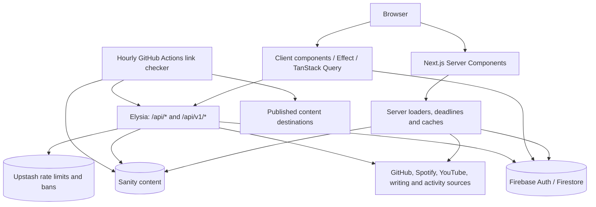

<!--
  Copyright (c) 2026 Mike Odnis

  Licensed under the Apache License, Version 2.0 (the "License");
  you may not use this file except in compliance with the License.
  You may obtain a copy of the License at

      http://www.apache.org/licenses/LICENSE-2.0

  Unless required by applicable law or agreed to in writing, software
  distributed under the License is distributed on an "AS IS" BASIS,
  WITHOUT WARRANTIES OR CONDITIONS OF ANY KIND, either express or implied.
  See the License for the specific language governing permissions and
  limitations under the License.
-->

# mikeodnis.dev

Portfolio, project case studies, writing and live activity for **Mike Odnis**
([WomB0ComB0](https://github.com/WomB0ComB0)). Built with Next.js and deployed at
[mikeodnis.dev](https://mikeodnis.dev).

[](https://github.com/WomB0ComB0/portfolio/releases)


## Contents

- [Architecture](#architecture)
- [Tech Stack](#tech-stack)
- [Routes & Pages](#routes--pages)
- [API Reference](#api-reference)
- [Quick Start](#quick-start)
- [Environment Variables](#environment-variables)
- [Scripts & Tooling](#scripts--tooling)
- [Verification](#verification)
- [Development Notes](#development-notes)
- [License](#license)

---

## Architecture

The site runs as one Next.js App Router application on Vercel. Server Components load and render the
main lists, while client components add filtering, dialogs, authentication and live playback or
presence updates.

- **Pages and shared UI**: route groups live in [`src/app/(routes)`](<src/app/(routes)>). The
  [console components](src/components/console) provide Folio headings, bylines, view switches,
  filter bars, tables and empty states. Projects offers Stories, Index and Screens views, with
  filter state carried in the URL.
- **Server data**: [Sanity loaders](src/lib/sanity/loaders.ts) supply portfolio content.
  [Media](<src/app/(routes)/(dev)/media/_lib/load-feed.ts>) and
  [Stats](<src/app/(routes)/(dev)/stats/_lib/console-loaders.ts>) combine sources with deadlines and
  cached fallbacks. Stats reports source freshness, while Media names unavailable source sections
  separately from empty results. Project case studies load confirmed related Media items through a
  separate bounded loader.
- **HTTP API and client queries**: Elysia routers under `/api/*` and `/api/v1/*` expose integration
  endpoints. Browser requests use [Effect DataLoader](src/providers/server/effect-data-loader.tsx),
  TanStack Query and typed clients. Server pages also call loaders directly, without an HTTP round
  trip through their own API.
- **Storage and authentication**: Sanity holds projects, roles, credentials, places and media
  metadata. Firebase handles visitor sign-in and Firestore stores guestbook messages. Upstash Redis
  holds API rate limits and IP/CIDR bans. Sanity also stores the scheduled link-check results.
- **Observability**: OpenTelemetry, Sentry and Better Stack report requests, errors and uptime.
  Server-rendered navigation links and JSON-LD support crawlers and navigation before hydration.



---

## Tech Stack

| Category                       | Technology                                                                | Usage                                                                                     |
| :----------------------------- | :------------------------------------------------------------------------ | :---------------------------------------------------------------------------------------- |
| **Runtime & Package Manager**  | Bun (`>=1.4.0`), Node.js (`>=24.15.0`)                                    | Dependency management, script execution, and local dev runtime                            |
| **Framework**                  | Next.js 16, React 19                                                      | App Router, Server Components, dynamic code splitting, and PWA support                    |
| **API Engine**                 | Elysia.js 1.4, `@elysiajs/eden`                                           | Type-safe REST handlers, OpenTelemetry spans, Server-Timing headers, and CORS             |
| **Data Pipeline & Validation** | Effect (`@effect/platform`, `effect/Schema`), Zod 4, ArkType              | Typed HTTP client pipelines, retry policies, and strict schema decoding                   |
| **State & Caching**            | TanStack React Query v5, Jotai 3, Upstash Redis                           | Suspense query caching, atomic client state, and server-side API rate limits and ban list |
| **Styling & Motion**           | Tailwind CSS v4, Radix UI, Motion 14, Paper Shaders                       | Component primitives, animations, and WebGL background shaders                            |
| **CMS & Database**             | Sanity v6 (`next-sanity`), Firebase v13 (`firebase`, `firebase-admin` 14) | Portfolio content management and authenticated guestbook entries                          |
| **Observability**              | Sentry 11, OpenTelemetry, Better Stack (`@logtail/node`)                  | Distributed tracing, error reporting, and `/api/status` uptime aggregation                |
| **Code Quality & Testing**     | Biome 2, TypeScript 6, Vitest 5, Playwright                               | Formatting, linting, static type checking, unit tests, and Chromium E2E tests             |

---

## Routes & Pages

| Route                               | Description                                                                                                                             |
| :---------------------------------- | :-------------------------------------------------------------------------------------------------------------------------------------- |
| `/`                                 | Home overview with project previews, current roles, activity and the command palette (`Cmd/Ctrl+K`).                                    |
| `/projects`                         | Stories, Index and Screens views of the project catalog, with search, kind and technology filters.                                      |
| `/projects/[id]`                    | Story case studies, project facts, screenshot galleries and confirmed related writing or videos.                                        |
| `/experience`, `/experience/[id]`   | Current roles, a career timeline and individual role stories.                                                                           |
| `/certifications`                   | Featured credentials, year chapters and issuer groups, with credential links and ID copy controls.                                      |
| `/resume`                           | PDF resume viewer and metadata from Sanity.                                                                                             |
| `/media`                            | Writing, Video and Streams sections with search, series filters, related items and project links. Playback opens externally by default. |
| `/stats`                            | A responsive console for GitHub, coding time, LeetCode, typing and Discord activity, with source freshness and fallback states.         |
| `/spotify`                          | A listening hero, ranked track ledger and artist strip, with live playback updates after hydration.                                     |
| `/places`, `/places/[placeId]`      | A map and place directory with detail pages and photo strips.                                                                           |
| `/places/photos`                    | A photo gallery drawn from the places collection.                                                                                       |
| `/guestbook`                        | Visitor notes arranged in a wall by year, with authenticated posting through the API.                                                   |
| `/sponsor`                          | Ways to support the work, followed by current and past supporter acknowledgements.                                                      |
| `/privacy`, `/cookies`, `/licenses` | Privacy, cookie and open-source license disclosures.                                                                                    |

Route-local components and loaders sit beside each page under `src/app/(routes)`. The `professioal`
directory spelling is part of the existing source layout.

---

## API Reference

### Core Endpoints (`/api/*`)

| Method | Path             | Description                                                                                                                                                                                                |
| :----- | :--------------- | :--------------------------------------------------------------------------------------------------------------------------------------------------------------------------------------------------------- |
| `GET`  | `/api/health`    | Liveness check with uptime and timestamp                                                                                                                                                                   |
| `GET`  | `/api/status`    | Service health aggregated from Better Stack Uptime monitors or status pages                                                                                                                                |
| `POST` | `/api/admin/ban` | Bearer-authenticated IP and CIDR ban management (`ADMIN_API_TOKEN`); the JSON body's `action` picks ban, unban, slow, list, etc., and an optional `seconds` makes a ban, slow-mode or CIDR entry temporary |

### v1 Endpoints (`/api/v1/*`)

| Method | Path                                         | Upstream Source          | Description                                                                                                                                                |
| :----- | :------------------------------------------- | :----------------------- | :--------------------------------------------------------------------------------------------------------------------------------------------------------- |
| `GET`  | `/api/v1/now-playing`                        | Spotify Web API          | Current playback state, track metadata, and album art                                                                                                      |
| `GET`  | `/api/v1/top-tracks`                         | Spotify Web API          | Short-term top tracks with resilient pagination fallback                                                                                                   |
| `GET`  | `/api/v1/top-artists`                        | Spotify Web API          | Short-term top artists and genres                                                                                                                          |
| `GET`  | `/api/v1/github-stats`                       | GitHub REST API          | Repository counts, stars, followers, top languages and top repositories                                                                                    |
| `GET`  | `/api/v1/github-sponsors`                    | GitHub GraphQL API       | Active and past GitHub Sponsors and tier metadata                                                                                                          |
| `GET`  | `/api/v1/wakatime`                           | WakaTime API             | Total coding time as text, digital, decimal and seconds values                                                                                             |
| `GET`  | `/api/v1/leetcode`                           | LeetCode GraphQL         | Solved problem counts by difficulty                                                                                                                        |
| `GET`  | `/api/v1/lanyard`                            | Lanyard API              | Live Discord presence and custom activities                                                                                                                |
| `GET`  | `/api/v1/blog`                               | Hashnode & Dev.to        | Merged and chronologically sorted blog articles                                                                                                            |
| `GET`  | `/api/v1/link-health?scope=projects`         | Cached HTTP checks       | Link status for `projects`, `media`, `certifications` or `experience`; accepts a scope, never a target URL                                                 |
| `GET`  | `/api/v1/link-health/catalog?scope=projects` | Published portfolio data | Fixed-scope URL catalog for the scheduled checker; accepts no target URL                                                                                   |
| `GET`  | `/api/v1/google`                             | Google Analytics         | Total site pageviews                                                                                                                                       |
| `POST` | `/api/v1/messages`                           | Firebase Admin           | Sign the guestbook with a Firebase ID token (see [Guestbook posts](#guestbook-posts))                                                                      |
| `GET`  | `/api/v1/sanity/*`                           | Sanity CMS               | Sub-routes: `/resume`, `/experiences`, `/projects`, `/projects/featured`, `/certifications`, `/places`, `/presentations`, `/talks`, `/articles`, `/videos` |

The v1 router also exposes `/api/v1/`, `/api/v1/health`, `/api/v1/status`, `/api/v1/version` and
`/api/v1/info` through its [utility module](src/app/api/v1/[[...route]]/utility/index.ts). `/info`
currently contains placeholder contact and documentation values. `/api/v1/github-sponsors/active`
returns the active sponsorship list.

The Media page composes its feed on the server from the blog, Sanity and YouTube loaders. It does
not have a separate `/api/v1/media` endpoint.

### Content-link health

An [hourly workflow](.github/workflows/link-health.yml) checks published project demos and source
repositories, writing and talk destinations, credentials and experience links. It checks only due
URLs and saves the results as separate `linkHealth` documents in Sanity. Page visits read cached
results; they never start external probes. Places, Spotify, standalone video feeds and stable
service/profile links remain outside the catalog.

Only a repeatedly confirmed missing page receives an **Unavailable** label. The checker verifies
`404`/`410` with GET and requires separated observations. Timeouts, authentication walls, rate limits,
server errors and inconclusive checks produce no visitor warning. Notion pages cannot support a
missing-page warning because their automated responses are not reliable evidence of availability.
Links remain clickable, recovery clears warnings, and warnings expire after 24 hours without a
fresh observation. HTTP checks cannot detect every soft 404 or broken application feature.

The workflow handles up to 100 due URLs per run, with two concurrent probes and a five-minute run
budget. Each probe keeps its five-second total deadline, validates DNS and redirects, pins the
connection to a public address, verifies TLS, and consumes no response body. Overlapping workflow
runs are serialized. Results are saved as one revision-guarded atomic batch; earlier failures leave
the previous records in place.

Configure `SANITY_LINK_HEALTH_TOKEN` as a GitHub Actions secret using a dedicated Sanity project
write token. The site keeps its read-only credential. The workflow reuses the existing
`NEXT_PUBLIC_SANITY_PROJECT_ID` secret and the production dataset. Run it manually with
`gh workflow run link-health.yml -f dry_run=false`; manual runs default to a dry run. No URL or
credential is supplied through the public API.

### Experience role histories

An experience can hold optional `subRoles` in Studio. Each child has its own title, dates, description,
responsibilities and technologies. The index shows a compact nested progression; the detail page
shows the roles and their staggered ranges within the overall employment period. Legitimate overlaps
are supported. The main clock still counts the parent engagement once, so promotions and parallel
sub-roles do not inflate the overall tenure or concurrency figures. Existing single-role entries
keep their current presentation.

### Rate Limits & Bans

Requests to `/api/*` and `/api/v1/*` pass an Elysia `onRequest` guard
([`src/lib/security/api-guard.ts`](src/lib/security/api-guard.ts)) before routing. `/api/health`,
CORS preflights and the separate `/api/og` image route are not guarded. Limits are sliding windows
per client IP (IPv6 clients per /64 network):

| Route class                                     | Limit                | Ban list applies |
| :---------------------------------------------- | :------------------- | :--------------- |
| `POST /api/v1/messages` (signing the guestbook) | 5 posts per 10 min   | Yes              |
| Other `/api/v1/*`                               | 60 requests per 60 s | Yes              |
| `/api/admin/*`                                  | 5 requests per 10 s  | No               |
| Other `/api/*`                                  | 30 requests per 60 s | Yes              |
| IPs in slow mode                                | 1 request per 30 s   | Yes              |

- Banned IPs and IPs inside a banned CIDR range receive `403`. Clients over a limit receive `429`
  with `Retry-After` and `RateLimit-*` headers. Both responses are sent with
  `Cache-Control: no-store`.
- Ban-list entries are sorted sets in Upstash Redis scored by their expiry time. Permanent entries
  use a far-future score. Expired entries are ignored by the guard and deleted from every list
  whenever the ban API adds, removes or lists entries.
- The ban-list read and the rate-limit counter run as one parallel Upstash round trip with a 300 ms
  budget. An in-process limit of 100 requests per minute per instance also applies.

### Guestbook posts

`POST /api/v1/messages` signs the guestbook. The `/guestbook` page lists the messages on the server,
so there is no `GET`.

- **Request**: `Authorization: Bearer <Firebase ID token>` (from the signed-in visitor, a guest
  included) and a JSON body `{ "message": "..." }` of 1 to 280 characters.
- **Checks, in order**: the guard above (bans, then the 5-per-10-minute `guestbook` limit), the body
  schema (`400`), the token (`401`), then the text itself (`400` when nothing is left once markup is
  removed). Nothing is written until every check passes.
- **Token**: verified on the server with [`jose`](https://github.com/panva/jose), by
  [Firebase's rules for third-party JWT libraries](https://firebase.google.com/docs/auth/admin/verify-id-tokens#verify_id_tokens_using_a_third-party_jwt_library):
  an `RS256` signature by one of Google's securetoken keys (named by the token's `kid`, fetched from
  Google's public JSON Web Key Set and cached), `aud` the project id, `iss`
  `https://securetoken.google.com/<project id>`, `exp` in the future, `iat` and `auth_time` in the
  past (10 s of clock skew allowed), and a non-empty `sub` (the uid). There is no revocation lookup.
  A missing, malformed, invalid or expired token gets `401` with `{ "error": "..." }` and a
  `WWW-Authenticate: Bearer realm="guestbook"` header. The body is the same in every case. A refused
  token's error code and the claim at fault (nothing else) are logged as an error. When
  `GCP_PROJECT_ID` and `NEXT_PUBLIC_FIREBASE_PROJECT_ID` differ, every post gets a reported `500`
  instead of a silent `401`. So does a failure to fetch Google's keys (unreachable, a timeout, or an
  answer that is not a key set), so the browser does not sign a valid visitor out.
- **Auth module boundary**: token verification imports `jose` directly. `firebase-admin` remains
  responsible for Firestore writes. A regression test prevents importing `firebase-admin/auth` into
  the shared API module, which previously caused module-loading failures on runtimes without
  `require(esm)` support.
- **Stored**: the checked text as plain text, and the name their Google or GitHub sign-in carries. A
  guest, or a sign-in method the site does not offer, is stored as `Anonymous`. A name sent in the
  body is ignored. The name is the visitor's own Firebase profile name, which they can change, so
  the `uid` is what identifies a poster. The message collection is publicly readable, so the `uid`
  is not on the message: it is kept in a server-only document with the same id under
  `artifacts/{appId}/private/data/messagePoster`, written in the same batch, and never returned.
- **In the browser**: the card sends the visitor's ID token. After a `401` it sends the post once
  more with a token Firebase refreshes on purpose (a `401` stores nothing); refused again, it signs
  the visitor out and asks them to sign in again, keeping their text.
- **Limits of the check**: guest sign-in uses the public web config, so anyone can get a valid
  token; the sign-in check gives each post a `uid`, not spam resistance. The per-IP `guestbook`
  limit is the control against floods (while Redis is failing, the guard lets requests through and
  only the per-instance in-process limit applies).
- **Firestore rules** (deployed in the Firebase console; not in this repo): the messages collection
  `artifacts/{appId}/public/data/message` must allow public `read` (the page loader reads it with
  the client SDK) and deny every client `create`, `update` and `delete`. Every other path,
  `messagePoster` included, must deny clients both reads and writes. The Admin SDK ignores rules, so
  the API still writes. If clients may write there, anyone can skip this API and its checks.

---

## Quick Start

### Prerequisites

- **Bun** `>= 1.4.0` (CI uses `1.4.4`)
- **Node.js** `>= 24.15.0`

### Setup

```bash
git clone https://github.com/WomB0ComB0/portfolio.git
cd portfolio
bun install --frozen-lockfile
cp .env.example .env.local
```

Bun 1.4 or newer is required for the version-scoped dependency overrides in `package.json`. Keep the
committed `bun.lock` when setting up the project.

Populate the required values in `.env.local` (see [Environment Variables](#environment-variables)),
then start the development server:

```bash
bun dev
```

- **App**: `http://localhost:3000`
- **API v1**: `http://localhost:3000/api/v1`
- **Health**: `http://localhost:3000/api/health`

---

## Environment Variables

Validation is enforced at build and startup via [`src/env.ts`](src/env.ts) (`@t3-oss/env-nextjs`).
Copy [`.env.example`](.env.example) to `.env.local`.

### Required Variables

| Variable                            | Scope  | Description                                                                                                                                                  |
| :---------------------------------- | :----- | :----------------------------------------------------------------------------------------------------------------------------------------------------------- |
| `CSRF_SECRET`                       | Server | Secret key for CSRF token signing                                                                                                                            |
| `ADMIN_API_TOKEN`                   | Server | Bearer token for `/api/admin/ban` endpoints                                                                                                                  |
| `BETTERSTACK_API_KEY`               | Server | Better Stack Uptime API key for `/api/status`                                                                                                                |
| `NEXT_PUBLIC_SANITY_PROJECT_ID`     | Client | Sanity CMS project ID (`NEXT_PUBLIC_SANITY_DATASET` defaults to `production`)                                                                                |
| `NEXT_PUBLIC_FIREBASE_*`            | Client | Firebase client config (`API_KEY`, `AUTH_DOMAIN`, `PROJECT_ID`, `STORAGE_BUCKET`, `MESSAGING_SENDER_ID`, `APP_ID`, `MEASUREMENT_ID`)                         |
| `GCP_*`                             | Server | GCP service account credentials (`GCP_PROJECT_ID`, `GCP_PRIVATE_KEY_ID`, `GCP_PRIVATE_KEY`, `GCP_CLIENT_EMAIL`, `GCP_CLIENT_ID`, `GCP_CLIENT_X509_CERT_URL`) |
| `UPSTASH_REDIS_REST_URL`            | Server | Upstash Redis REST endpoint                                                                                                                                  |
| `UPSTASH_REDIS_REST_TOKEN`          | Server | Upstash Redis REST token (read/write; never expose it as `NEXT_PUBLIC_`)                                                                                     |
| `NEXT_PUBLIC_DISCORD_ID`            | Client | Discord user ID for Lanyard presence                                                                                                                         |
| `NEXT_PUBLIC_LIVEBLOCKS_PUBLIC_KEY` | Client | Liveblocks public key                                                                                                                                        |
| `NEXT_PUBLIC_SENTRY_DSN`            | Client | Sentry DSN for client/server error reporting                                                                                                                 |

`GCP_PROJECT_ID` is also the project whose Firebase ID tokens `POST /api/v1/messages` accepts, so it
must name the same Firebase project as `NEXT_PUBLIC_FIREBASE_PROJECT_ID`. Verifying tokens needs
only that project id. The other `GCP_*` values are the service account the guestbook writes with.

### Optional Integrations

| Variable                                                              | Scope  | Description                                                                                                 |
| :-------------------------------------------------------------------- | :----- | :---------------------------------------------------------------------------------------------------------- |
| `SPOTIFY_CLIENT_ID`, `SPOTIFY_CLIENT_SECRET`, `SPOTIFY_REFRESH_TOKEN` | Server | OAuth credentials for `/api/v1/now-playing`, `/top-tracks`, and `/top-artists`                              |
| `GITHUB_TOKEN`                                                        | Server | GitHub PAT (`read:user`, `read:org`) for `/api/v1/github-stats` and `/github-sponsors`                      |
| `WAKA_TIME_API_KEY`                                                   | Server | WakaTime API key for coding telemetry                                                                       |
| `SANITY_API_TOKEN`                                                    | Server | Sanity read token for server-side content queries                                                           |
| `YOUTUBE_SERVER_API_KEY`                                              | Server | YouTube Data API v3 key for channel uploads and talk durations, sent in the `X-Goog-Api-Key` request header |
| `BETTERSTACK_STATUS_PAGE_ID`                                          | Server | Optional specific Better Stack status page ID                                                               |
| `BETTERSTACK_SOURCE_TOKEN`, `BETTERSTACK_INGESTING_HOST`              | Server | Optional Better Stack Telemetry (Logtail) source token and host for log shipping                            |
| `NEXT_PUBLIC_GOOGLE_MAPS_API_KEY`, `NEXT_PUBLIC_GOOGLE_MAPS_MAP_ID`   | Client | Google Maps credentials for `/places`                                                                       |

---

## Scripts & Tooling

```bash
# Development & Production
bun dev                        # Start Next.js development server
bun run build                  # Run security audit, bundle cost analysis, and production build
bun start                      # Start production server

# Code Quality & Verification
bun run lint                   # Check with Biome (biome ci) and Stylelint; fails on errors, writes nothing
bun run lint:fix               # Apply Biome and Stylelint fixes
bun run format                 # Format files with Prettier
bun run type                   # Run TypeScript compiler check (tsc --noEmit)
bun run test                   # Run unit tests via Vitest (vitest run)
bun run e2e:ci                 # Run Playwright E2E test suite on Chromium

# Bundle & Repository Maintenance
bun run analyze                # Build with @next/bundle-analyzer and report bundle sizes
bun run scripts:package-cost   # Measure dependency size impact
bun run scripts:check-unused   # Detect unused files and exports
bun run gen                    # Regenerate GitHub schema types from the installed schema package
bun run scripts:copyright      # Add or repair source license headers
bun run scripts:copyright:check # Check headers without writing

# Sanity Studio
bun run sanity:dev             # Start the standalone content studio
bun run sanity:build           # Build the studio
```

---

## Verification

Run static checks and the unit suite with the scripts defined in [package.json](package.json):

```bash
bun run type
bun run lint
bun run test
```

Use `bun run test`, which starts Vitest. `bun test` invokes Bun's own runner and does not use the
repository's Vitest setup. For a focused regression check:

```bash
bunx vitest run tests/unit/console/folio --no-ui --no-api
```

Run browser checks with Playwright:

```bash
bun run e2e:ci
# Or run a focused set after installing Chromium:
bunx playwright install chromium
bunx playwright test e2e/seo/server-render.spec.ts e2e/journeys/media.spec.ts --project=chromium
```

The default [Playwright config](playwright.config.ts) starts a development server on port 3000 and
reuses an existing server locally. Journey tests cover desktop and phone layouts, URL filters,
keyboard focus and reduced motion. The server-render suite checks content without JavaScript,
structured navigation and real 404 responses. Resume retains its streamed loading exception. The
guestbook and console-route fixtures block writes during their live-data checks.

The screenshot tests attach images for review when no matching baseline exists. Visual comparison
begins only after a baseline has been deliberately created and reviewed. See
[the E2E guide](e2e/README.md) for report and baseline handling. A Chromium run does not establish
Safari or physical-device coverage.

## Development Notes

- **Content**: edit Sanity documents through the standalone Studio. Configure the site with a
  read-only `SANITY_API_TOKEN`, keeping editor credentials separate from runtime content queries.
- **Data failures**: Media and Stats use bounded source loads and stale cache fallbacks. Preserve
  their error and empty states when changing a loader, along with Stats freshness labels and Media
  source-availability notices.
- **Rendering**: keep primary content and navigation in server HTML. Projects and Media encode
  filters in the URL, and their controls support normal links or GET forms before JavaScript takes
  over.
- **Dependency updates**: keep the cookie override compatible with Elysia and the GraphQL tools
  override scoped by version. After changing GraphQL codegen dependencies, run `bun run gen` and
  inspect `src/generated/graphql.ts` as well as the normal type and build checks.
- **Framework changes**: read the documentation shipped in `node_modules/next/dist/docs/` before
  changing Next.js routing, caching or metadata behavior.
- **Current scope**: writing comes from external feeds and Sanity, and the site uses English
  content. Stats uses DOM/SVG charts. There is no repository MDX publishing pipeline, locale routing
  or Three.js stats scene.

---

## License

Licensed under the **Apache License, Version 2.0**. See the license headers in source files or
[http://www.apache.org/licenses/LICENSE-2.0](http://www.apache.org/licenses/LICENSE-2.0) for full
terms.
