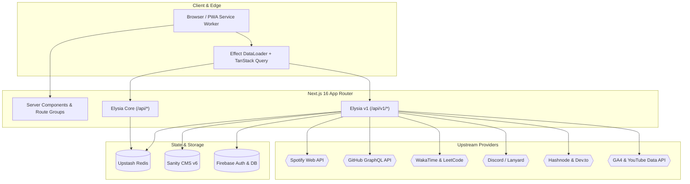

<!--
  Copyright (c) 2026 Mike Odnis

  Licensed under the Apache License, Version 2.0 (the "License");
  you may not use this file except in compliance with the License.
  You may obtain a copy of the License at

      http://www.apache.org/licenses/LICENSE-2.0

  Unless required by applicable law or agreed to in writing, software
  distributed under the License is distributed on an "AS IS" BASIS,
  WITHOUT WARRANTIES OR CONDITIONS OF ANY KIND, either express or implied.
  See the License for the specific language governing permissions and
  limitations under the License.
-->

# mikeodnis.dev

Personal portfolio, telemetry dashboard, and API hub for **Mike Odnis** ([WomB0ComB0](https://github.com/WomB0ComB0)), live at [mikeodnis.dev](https://mikeodnis.dev).


## Contents

- [Architecture](#architecture)
- [Tech Stack](#tech-stack)
- [Routes & Pages](#routes--pages)
- [API Reference](#api-reference)
- [Quick Start](#quick-start)
- [Environment Variables](#environment-variables)
- [Scripts & Tooling](#scripts--tooling)
- [Scope & Architecture Decisions](#scope--architecture-decisions)
- [License](#license)

---

## Architecture

The application runs as a single Next.js 16 deployment on Vercel, splitting UI rendering from external API orchestration:

1. **Presentation Layer (`src/app/(routes)`)**: React 19 Server and Client Components styled with Tailwind CSS v4 and Radix UI primitives. Client data fetching uses a custom [`DataLoader`](src/providers/server/effect-data-loader.tsx) built on `@effect/platform`, `effect/Schema`, and `@tanstack/react-query` (`useSuspenseQuery`).
2. **API Layer (`src/app/api`)**: Two Elysia.js routers mounted inside Next.js App Router catch-all handlers (`/api/[[...route]]` and `/api/v1/[[...route]]`). Routes enforce IP-based rate limiting via Upstash Redis, CIDR/IP ban checks, security headers, and runtime schema validation.
3. **Content & Persistence**:
   - **Sanity CMS v6**: Structured content for projects, work experience, certifications, places, talks, presentations, articles, and resume metadata.
   - **Upstash Redis**: Stale-while-revalidate caching, rate limiting, and IP ban lists.
   - **Firebase v13**: Authentication and real-time storage for the `/guestbook` route.
4. **Observability**: OpenTelemetry instrumentation (`src/instrumentation.ts`), Sentry error tracking, and Better Stack uptime monitoring and log ingestion.



---

## Tech Stack

| Category | Technology | Usage |
| :--- | :--- | :--- |
| **Runtime & Package Manager** | Bun (`>=1.0.0`), Node.js (`>=24.15.0`) | Dependency management, script execution, and local dev runtime |
| **Framework** | Next.js 16, React 19 | App Router, Server Components, dynamic code splitting, and PWA support |
| **API Engine** | Elysia.js 1.4, `@elysiajs/eden` | Type-safe REST handlers, OpenTelemetry spans, Server-Timing headers, and CORS |
| **Data Pipeline & Validation** | Effect (`@effect/platform`, `effect/Schema`), Zod 4, ArkType | Typed HTTP client pipelines, retry policies, and strict schema decoding |
| **State & Caching** | TanStack React Query v5, Jotai 3, Upstash Redis | Suspense query caching, atomic client state, and server-side rate limiting |
| **Styling & Motion** | Tailwind CSS v4, Radix UI, Motion 14, Paper Shaders | Component primitives, animations, and WebGL background shaders |
| **CMS & Database** | Sanity v6 (`next-sanity`), Firebase v13 (`firebase`, `firebase-admin` 14) | Portfolio content management and authenticated guestbook entries |
| **Observability** | Sentry 11, OpenTelemetry, Better Stack (`@logtail/node`) | Distributed tracing, error reporting, and `/api/status` uptime aggregation |
| **Code Quality & Testing** | Biome 2, TypeScript 6, Vitest 5, Playwright | Formatting, linting, static type checking, unit tests, and Chromium E2E tests |

---

## Routes & Pages

| Route | Source | Description |
| :--- | :--- | :--- |
| `/` | `src/app/page.tsx` | Home view with interactive canvas, command palette (`Cmd+K`), and quick links |
| `/projects`, `/projects/[id]` | `src/app/(routes)/(main)/(professioal)/projects` | Full project catalog and individual project case studies from Sanity |
| `/experience`, `/experience/[id]` | `src/app/(routes)/(main)/(professioal)/experience` | Career timeline and role details |
| `/certifications` | `src/app/(routes)/(main)/(professioal)/certifications` | Technical certifications and credentials |
| `/resume` | `src/app/(routes)/(main)/(professioal)/resume` | Interactive PDF resume viewer with Sanity-backed metadata |
| `/media` | `src/app/(routes)/(dev)/media` | Unified feed of Hashnode and Dev.to blog posts, talks, presentations, and YouTube videos |
| `/stats` | `src/app/(routes)/(dev)/stats` | Live engineering telemetry: GitHub contributions, WakaTime hours, LeetCode stats, Discord status, and site analytics |
| `/spotify` | `src/app/(routes)/(main)/(personal)/spotify` | Real-time Spotify playback, top tracks, and top artists |
| `/places`, `/places/[placeId]` | `src/app/(routes)/(main)/(personal)/places` | Curated map and directory of favorite locations using `@vis.gl/react-google-maps` |
| `/guestbook` | `src/app/(routes)/(main)/(personal)/guestbook` | Authenticated visitor messages backed by Firebase |
| `/sponsor` | `src/app/(routes)/(dev)/sponsor` | GitHub Sponsors tiers, current backers, and contribution links |
| `/privacy`, `/cookies`, `/licenses` | `src/app/(routes)/(legal)` | Legal and open-source license disclosures |

---

## API Reference

### Core Endpoints (`/api/*`)

| Method | Path | Description |
| :--- | :--- | :--- |
| `GET` | `/api/health` | Liveness check with uptime and timestamp |
| `GET` | `/api/status` | Service health aggregated from Better Stack Uptime monitors or status pages |
| `POST` | `/api/admin/ban` | Bearer-authenticated IP and CIDR ban management (`ADMIN_API_TOKEN`); the JSON body's `action` picks ban, unban, slow, list, etc. |

### v1 Endpoints (`/api/v1/*`)

| Method | Path | Upstream Source | Description |
| :--- | :--- | :--- | :--- |
| `GET` | `/api/v1/now-playing` | Spotify Web API | Current playback state, track metadata, and album art |
| `GET` | `/api/v1/top-tracks` | Spotify Web API | Short-term top tracks with resilient pagination fallback |
| `GET` | `/api/v1/top-artists` | Spotify Web API | Short-term top artists and genres |
| `GET` | `/api/v1/github-stats` | GitHub GraphQL API | Repositories, stars, followers, and contribution calendar |
| `GET` | `/api/v1/github-sponsors` | GitHub GraphQL API | Active and past GitHub Sponsors and tier metadata |
| `GET` | `/api/v1/wakatime` | WakaTime API | Total coding time and language breakdown |
| `GET` | `/api/v1/leetcode` | LeetCode GraphQL | Solved problem counts by difficulty |
| `GET` | `/api/v1/lanyard` | Lanyard API | Live Discord presence and custom activities |
| `GET` | `/api/v1/blog` | Hashnode & Dev.to | Merged and chronologically sorted blog articles |
| `GET` | `/api/v1/google` | Google Analytics / YouTube | Site pageviews and YouTube channel videos |
| `GET`, `POST` | `/api/v1/messages` | Firebase Admin | Fetch and post guestbook messages |
| `GET` | `/api/v1/sanity/*` | Sanity CMS | Sub-routes: `/resume`, `/experiences`, `/projects`, `/projects/featured`, `/certifications`, `/places`, `/presentations`, `/talks`, `/articles`, `/videos` |

---

## Quick Start

### Prerequisites

- **Bun** `>= 1.0.0`
- **Node.js** `>= 24.15.0`

### Setup

```bash
git clone https://github.com/WomB0ComB0/portfolio.git
cd portfolio
bun install
cp .env.example .env.local
```

Populate the required keys in `.env.local` (see [Environment Variables](#environment-variables)), then start the development server:

```bash
bun dev
```

- **App**: `http://localhost:3000`
- **API v1**: `http://localhost:3000/api/v1`
- **Health**: `http://localhost:3000/api/health`

---

## Environment Variables

Validation is enforced at build and startup via [`src/env.ts`](src/env.ts) (`@t3-oss/env-nextjs`). Copy [`.env.example`](.env.example) to `.env.local`.

### Required Variables

| Variable | Scope | Description |
| :--- | :--- | :--- |
| `CSRF_SECRET` | Server | Secret key for CSRF token signing |
| `ADMIN_API_TOKEN` | Server | Bearer token for `/api/admin/ban` endpoints |
| `BETTERSTACK_API_KEY` | Server | Better Stack Uptime API key for `/api/status` |
| `NEXT_PUBLIC_SANITY_PROJECT_ID` | Client | Sanity CMS project ID (`NEXT_PUBLIC_SANITY_DATASET` defaults to `production`) |
| `NEXT_PUBLIC_FIREBASE_*` | Client | Firebase client config (`API_KEY`, `AUTH_DOMAIN`, `PROJECT_ID`, `STORAGE_BUCKET`, `MESSAGING_SENDER_ID`, `APP_ID`, `MEASUREMENT_ID`) |
| `GCP_*` | Server | GCP service account credentials (`GCP_PROJECT_ID`, `GCP_PRIVATE_KEY_ID`, `GCP_PRIVATE_KEY`, `GCP_CLIENT_EMAIL`, `GCP_CLIENT_ID`, `GCP_CLIENT_X509_CERT_URL`) |
| `UPSTASH_REDIS_REST_URL` | Server | Upstash Redis REST endpoint |
| `UPSTASH_REDIS_REST_TOKEN` | Server | Upstash Redis REST token (read/write; never expose it as `NEXT_PUBLIC_`) |
| `NEXT_PUBLIC_DISCORD_ID` | Client | Discord user ID for Lanyard presence |
| `NEXT_PUBLIC_LIVEBLOCKS_PUBLIC_KEY` | Client | Liveblocks public key |
| `NEXT_PUBLIC_SENTRY_DSN` | Client | Sentry DSN for client/server error reporting |

### Optional Integrations

| Variable | Scope | Description |
| :--- | :--- | :--- |
| `SPOTIFY_CLIENT_ID`, `SPOTIFY_CLIENT_SECRET`, `SPOTIFY_REFRESH_TOKEN` | Server | OAuth credentials for `/api/v1/now-playing`, `/top-tracks`, and `/top-artists` |
| `GITHUB_TOKEN` | Server | GitHub PAT (`read:user`, `read:org`) for `/api/v1/github-stats` and `/github-sponsors` |
| `WAKA_TIME_API_KEY` | Server | WakaTime API key for coding telemetry |
| `SANITY_API_TOKEN` | Server | Sanity read token for private datasets or draft previews |
| `YOUTUBE_SERVER_API_KEY` | Server | YouTube Data API v3 key |
| `BETTERSTACK_STATUS_PAGE_ID` | Server | Optional specific Better Stack status page ID |
| `BETTERSTACK_SOURCE_TOKEN`, `BETTERSTACK_INGESTING_HOST` | Server | Optional Better Stack Telemetry (Logtail) source token and host for log shipping |
| `NEXT_PUBLIC_GOOGLE_MAPS_API_KEY`, `NEXT_PUBLIC_GOOGLE_MAPS_MAP_ID` | Client | Google Maps credentials for `/places` |

---

## Scripts & Tooling

```bash
# Development & Production
bun dev                        # Start Next.js development server
bun run build                  # Run security audit, bundle cost analysis, and production build
bun start                      # Start production server

# Code Quality & Verification
bun run lint                   # Run Biome check/fix and Stylelint on SCSS/CSS
bun run format                 # Format files with Prettier
bun run type                   # Run TypeScript compiler check (tsc --noEmit)
bun run test                   # Run unit tests via Vitest (vitest run)
bun run e2e:ci                 # Run Playwright E2E test suite on Chromium

# Bundle & Repository Maintenance
bun run analyze                # Build with @next/bundle-analyzer and report bundle sizes
bun run scripts:package-cost   # Measure dependency size impact
bun run scripts:check-unused   # Detect unused files and exports
bun run scripts:copyright      # Apply or verify Apache 2.0 license headers
```

---

## Scope & Architecture Decisions

To keep initial page loads fast and avoid client bundle bloat, several previously listed roadmap items have been completed or intentionally excluded:

- **[x] Blog & Media Engine (Completed)**: Live at [`/media`](src/app/(routes)/(dev)/media/page.tsx), [`/api/v1/blog`](src/app/api/v1/[[...route]]/blog/handlers.ts), and [`/api/v1/sanity/*`](src/app/api/v1/[[...route]]/sanity/index.ts). Posts are fetched concurrently from Hashnode (`blog.mikeodnis.dev`) and Dev.to (`mikeodnis`), alongside talks, presentations, and videos from Sanity and YouTube. An in-repo MDX compiler (`@next/mdx`, `shiki`) was skipped to keep server bundles small.
- **[x] Sponsorship Page (Completed)**: Live at [`/sponsor`](src/app/(routes)/(dev)/sponsor/page.tsx) with GitHub GraphQL integration at [`/api/v1/github-sponsors`](src/app/api/v1/[[...route]]/github-sponsors/handlers.ts).
- **[ ] Interactive 3D Stats via Three.js / React Three Fiber (Excluded for Performance)**: [`/stats`](src/app/(routes)/(dev)/stats/page.tsx) renders telemetry with 2D SVG and Recharts components. Pulling in `three` and `@react-three/fiber` adds ~150–250 KB of gzipped client JavaScript plus WebGL context overhead, degrading Largest Contentful Paint (LCP) and Total Blocking Time (TBT) on mobile devices.
- **[ ] Internationalization / i18n (Excluded for Performance)**: All portfolio content and technical articles are authored in English. Adding i18n routing middleware introduces per-request edge latency, duplicates route trees (`/[locale]/...`), increases client dictionary payloads, and fragments Redis/CDN cache keys.

---

## License

Licensed under the **Apache License, Version 2.0**. See the license headers in source files or [http://www.apache.org/licenses/LICENSE-2.0](http://www.apache.org/licenses/LICENSE-2.0) for full terms.
